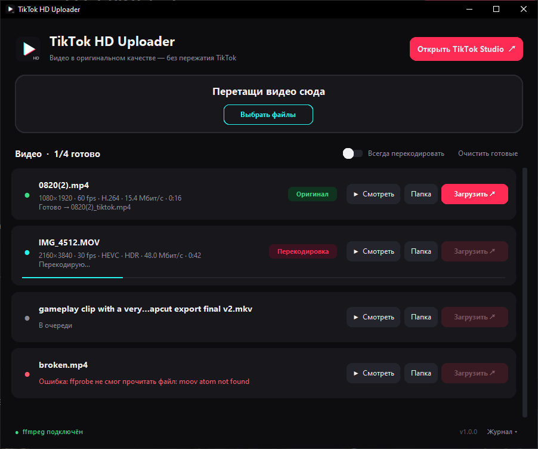

<div align="center">


# TikTok HD Uploader

**Видео в TikTok в оригинальном качестве: без пережатия в 540p**

[](https://github.com/Togziq/tiktok-hd-uploader/releases/latest)

[](LICENSE)



</div>

## Зачем это

Обычный ролик TikTok пережимает до 540p со скоростью около 0,5 Мбит/с, поэтому даже
идеальный исходник с айфона в ленте превращается в кашу.

Программа готовит файл так, что TikTok отдаёт зрителям **твой исходный файл как есть**.
Пример на одном и том же ролике:

| | Обычная загрузка | Через TikTok HD Uploader |
|---|---|---|
| Что отдаёт TikTok | своя пережатая версия | **твой оригинал** |
| Разрешение | 576×1024 | **1080×1920** |
| Битрейт | ~0,8 Мбит/с | **~15 Мбит/с** |

## Установка

1. Открой страницу **[Releases](https://github.com/Togziq/tiktok-hd-uploader/releases/latest)**
   и скачай `TikTok-HD-Uploader.exe`.
2. Запусти его. Устанавливать ничего не нужно, это один файл.
3. Если Windows покажет окно «Система Windows защитила ваш компьютер», нажми
   **Подробнее → Выполнить в любом случае**. Так бывает со всеми программами без
   платной цифровой подписи ([почему](#антивирус-или-windows-ругается)).
4. **ffmpeg** (по желанию). Без него обрабатываются только MP4 из CapCut, а с ним
   работают MOV с айфона, HDR, 4K, MKV, WebM и предпросмотр. Если ffmpeg не найден,
   внизу окна будет кнопка **«Установить ffmpeg»**. Можно поставить и вручную:

   ```powershell
   winget install Gyan.FFmpeg
   ```

## Как пользоваться

1. **Экспортируй ролик**, например из CapCut: 1080×1920, 30 или 60 fps, высокий битрейт,
   **HDR выключен**.
2. **Перетащи видео в окно программы** или нажми «Выбрать файлы». Можно сразу несколько.
3. Дождись зелёной точки. Рядом с исходником появится `имя_tiktok.mp4`.
4. Нажми **«Загрузить ↗»**: откроется TikTok Studio, а готовый файл выделится в проводнике.
5. Перетащи `_tiktok.mp4` в TikTok Studio **в браузере на компьютере**.

> [!IMPORTANT]
> Загружай **через браузер на компьютере** ([TikTok Studio](https://www.tiktok.com/tiktokstudio/upload)).
> Приложение TikTok на телефоне может пережать файл ещё до отправки, и тогда трюк не сработает.

> [!NOTE]
> Готовые `_tiktok.mp4` могут не открываться в стандартном плеере Windows. Это нормально:
> у них специально «сломан» заголовок. Смотри их кнопкой **«Смотреть»** или в VLC.

### Что делает программа с файлом

Режим выбирается автоматически:

| Бейдж | Когда | Что происходит |
|---|---|---|
| 🟢 **Оригинал** | MP4, H.264/HEVC, до 1080p, SDR (обычный экспорт из CapCut) | Картинка не трогается, патчится только заголовок файла |
| 🔵 **Перепаковка** | Подходящий кодек, но контейнер не MP4 (MKV, MOV) | Перекладывается в MP4 без потери качества |
| 🔴 **Перекодировка** | HDR, 10 бит, больше 1080p, больше 60 fps, VP9/AV1 и т. п. | Перекодируется в H.264 SDR (CRF 16), по умолчанию в 1080p |

Переключатели над списком:
- **«Сохранять 4K (эксперимент)»** не уменьшает видео до 1080p ([подробнее](#можно-ли-выложить-в-4k)).
- **«Всегда перекодировать»** включает перекодировку принудительно, обычно он не нужен.

## Как это работает

В заголовке MP4 (атом `mvhd`) длительность ролика заменяется на максимально возможное
значение. Сами кадры не меняются. Конвертер TikTok спотыкается о такой файл и вместо своей
пережатой версии раздаёт исходный. Подробности есть в оригинальном проекте
[tiktok-lossless-upload](https://github.com/buwryme/tiktok-lossless-upload),
на котором основан патч.

Проверить результат можно так: открой свой ролик в браузере, в DevTools → Network найди
запрос к видео и сравни размер файла с размером `_tiktok.mp4`. Если они совпадают до байта,
всё сработало.

## Вопросы

### Антивирус или Windows ругается

Программа собрана [PyInstaller](https://pyinstaller.org/) в один `.exe` и не подписана
платным сертификатом. Такие файлы SmartScreen и некоторые антивирусы помечают по умолчанию.
Исходный код целиком открыт в этом репозитории, а `.exe` собирается автоматически в
[GitHub Actions](../../actions) из этого кода. Чтобы убедиться, что файл не подменён,
сверь контрольную сумму с `SHA256SUMS.txt` из релиза:

```powershell
Get-FileHash .\TikTok-HD-Uploader.exe -Algorithm SHA256
```

### Перестало работать

TikTok может закрыть эту лазейку в любой момент. Тогда новые ролики снова будут
пережиматься, а старые, возможно, переобработаются. **Сохраняй исходники.**
Если заметил, что перестало работать, создай [issue](../../issues).

### Можно ли выложить в 4K?

Экспериментально можно: включи **«Сохранять 4K (эксперимент)»** перед добавлением видео.
4K в H.264/HEVC без HDR патчится без перекодировки. HDR с айфона перекодируется в SDR
без уменьшения разрешения. Всё, что больше 4096 px по стороне (лимит TikTok), уменьшается
до 2160p.

По умолчанию режим выключен, и вот почему:
- При срабатывании трюка у TikTok остаётся **одна версия ролика**, твой оригинал, без лёгких
  копий для медленного интернета. 4K весит 40–60 Мбит/с, и у многих зрителей видео будет
  подтормаживать.
- Экраны большинства телефонов около 1080 px в ширину, поэтому разница с 1080p почти не видна.
- Пока не проверено, отдаёт ли TikTok пропатченный 4K-файл как есть.

### Меня забанят?

Случаев бана за это не известно, но это неофициальный способ, и гарантий нет.
Используй на свой риск.

## Сборка из исходников

Нужен Python 3.11+ на Windows.

```powershell
git clone https://github.com/Togziq/tiktok-hd-uploader.git
cd tiktok-hd-uploader
.\build.ps1
```

Готовый файл появится в `dist\TikTok-HD-Uploader.exe`. Запустить без сборки:

```powershell
python -m venv .venv
.\.venv\Scripts\pip install -r requirements.txt
.\.venv\Scripts\python app.py
```

| Файл | Что внутри |
|---|---|
| `app.py` | Интерфейс (CustomTkinter + drag-and-drop) |
| `core.py` | Анализ видео, выбор режима, вызовы ffmpeg |
| `tiktok_lossless_patch.py` | Патч MP4, взят без изменений из [tiktok-lossless-upload](https://github.com/buwryme/tiktok-lossless-upload) |
| `tiktok-hd-uploader.spec` | Настройки сборки PyInstaller |
| `.github/workflows/release.yml` | Автосборка `.exe` и публикация релиза |

### Выпуск новой версии

1. Поменяй `__version__` в `app.py`, например на `1.1.0`.
2. Закоммить и поставь тег с той же версией:

   ```powershell
   git tag v1.1.0
   git push origin main --tags
   ```

3. GitHub Actions сам соберёт `.exe` и опубликует релиз с `SHA256SUMS.txt`.

## Благодарности и лицензия

- Патч MP4: [buwryme/tiktok-lossless-upload](https://github.com/buwryme/tiktok-lossless-upload) (MIT)
- Интерфейс: [CustomTkinter](https://github.com/TomSchimansky/CustomTkinter), [tkinterdnd2](https://github.com/Eliav2/tkinterdnd2)
- Работа с видео: [FFmpeg](https://ffmpeg.org/)

Полный список лежит в [THIRD_PARTY_NOTICES.md](THIRD_PARTY_NOTICES.md). Код проекта распространяется под лицензией [MIT](LICENSE).

---

<sub>Проект не связан с TikTok и ByteDance. TikTok — товарный знак ByteDance Ltd.
Программа предоставляется «как есть», без каких-либо гарантий.</sub>
